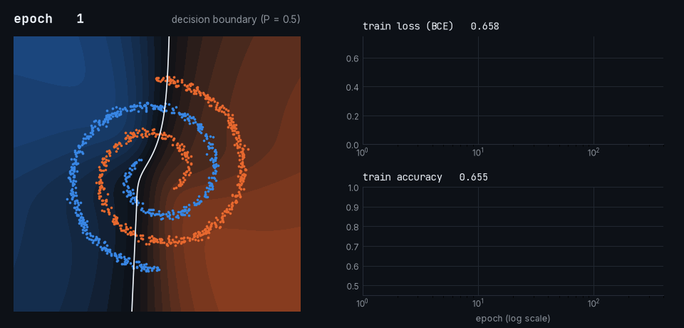
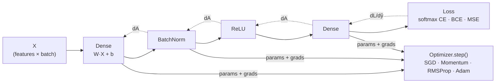

# DIY Neural Net

<p>
  
  
  
  
  <a href="LICENSE"></a>
</p>

**A deep-learning library written from scratch in NumPy, with every forward and backward pass derived by hand.** There is no autograd: each layer, activation and loss implements its own `backward()`, and the chain rule is visible in the code. The same code runs on the GPU when CuPy is installed and falls back to NumPy otherwise. It covers dense layers with He/Glorot initialization, BatchNorm with running statistics, inverted dropout, ReLU/Sigmoid/Tanh, softmax cross-entropy, BCE and MSE losses, SGD, momentum, RMSProp and Adam with bias correction, mini-batching and early stopping.

It is built to be read. The training loop is plain Python, each component is a small class, and the backward passes are checked against finite differences in the test suite.

<p align="center">
  
</p>
<p align="center"><sub>A 2-48-48-1 tanh network learning the two-spirals problem with this library (Adam, lr 0.01). Each frame is a real checkpoint; the background is the network's predicted probability over the plane.</sub></p>

## How it fits together



Every building block follows one contract:

| Base class | Implement | Examples in the library |
|---|---|---|
| `Layer` | `forward(X, train)`, `backward(dA)`, `params` / `grads` dicts | `Dense`, `BatchNorm`, `Dropout` |
| `Activation` | `forward(Z)`, `backward(dA)` | `ReLU`, `Sigmoid`, `Tanh` |
| `Loss` | `__call__(y, ŷ)`, `backward(y, ŷ)` | `CrossEntropyLossWithLogits`, `BCELoss`, `MSELoss` |
| `Optimizer` | `step()` over every layer's `params` and `grads` | `GradientDescent`, `GradientDescentWithMomentum`, `RMSProp`, `Adam` |

To add LeakyReLU, Huber loss or Adagrad, you subclass one of these and write the math.

## Quickstart

```bash
git clone https://github.com/mohamedkhayat/DIYNeuralNet.git
cd DIYNeuralNet
pip install -e ".[gpu]"     # CuPy for NVIDIA GPUs; use `pip install -e .` for CPU only
```

A Dockerfile with CUDA 12.8 and the CuPy build dependencies is included:

```bash
docker build -t diy-neural-net .
docker run -it --rm --gpus all -v "$(pwd)":/workspace diy-neural-net bash
```

Train a classifier on MNIST:

```python
from diy_neural_net import NeuralNetwork, Dense, BatchNorm, Dropout, ReLU, utils
from diy_neural_net.Losses import CrossEntropyLossWithLogits
from diy_neural_net.Optimizer import Adam

X, y = utils.load_mnist()                     # Data/train.csv, see "Data" below
X_train, X_test, y_train, y_test = utils.train_test_split(X, y, test_size=0.15)

model = NeuralNetwork.Sequential([
    Dense(784, 512, initializer="he"), BatchNorm(512), ReLU(),
    Dense(512, 256, initializer="he"), BatchNorm(256), ReLU(), Dropout(keep_prob=0.85),
    Dense(256, 128, initializer="he"), BatchNorm(128), ReLU(), Dropout(keep_prob=0.85),
    Dense(128, 10, initializer="glorot"),     # logits; the loss applies a stable softmax
])
model.set_loss(CrossEntropyLossWithLogits())

history = model.fit(X_train, y_train, optimizer=Adam(model, lr=1e-3), epochs=30, batch_size=64,
                    validation_data=(X_test, y_test), early_stopping_patience=5)
utils.plot_metrics(history)
```

Data is laid out as `(features, samples)`, matching the math in most textbooks.

## Results

The notebooks in `notebooks/` run end to end on the library:

| Notebook | Task | Result |
|---|---|---|
| `01_Binary_Classification` | MNIST, two classes (`Data/balanced_mnist_1.csv`) | 97.60% test accuracy, 3.8 s on GPU |
| `02_Multiclass_MNIST` | MNIST, 10 classes, network above | 97.90% test accuracy, early-stopped at epoch 16, 20.7 s on GPU |
| `03_Regression_Synthetic` | noisy synthetic regression, MSE | fitted curve vs. data plot |

Same 784-512-256-128-10 BatchNorm network, same seed, 12 epochs, batch 64, on 35,700 / 6,300 MNIST images (RTX 5090, CuPy):

| Optimizer | Val accuracy (final) | Val accuracy (best) | Time per epoch |
|---|---|---|---|
| SGD (lr 0.1) | 97.51% | 97.68% | 0.92 s |
| Momentum (lr 0.1, β 0.9) | 97.35% | 97.57% | 0.83 s |
| RMSProp (lr 1e-3) | 97.75% | 97.90% | 0.93 s |
| Adam (lr 1e-3) | 97.17% | 97.67% | 1.13 s |

<sub>Produced by `assets/readme/build_assets.py`; raw histories in `assets/readme/optimizers.json`.</sub>

## Correctness

Hand-written backward passes are easy to get subtly wrong, and adaptive optimizers like Adam can hide a mis-scaled gradient. `tests/test_gradients.py` therefore compares every analytic gradient (Dense, BatchNorm, softmax cross-entropy) against central finite differences, and checks that the softmax stays finite for very large logits.

```bash
pip install -e ".[dev]"
pytest
```

## Data

- `Data/balanced_mnist_1.csv` (binary task) is in the repository.
- `Data/train.csv` (10-class task) is the `train.csv` from Kaggle's [Digit Recognizer](https://www.kaggle.com/c/digit-recognizer/data) competition: 42,000 labelled images, pixel columns after a `label` column. Place it in `Data/`.

## Project layout

```
src/diy_neural_net/
├── Network.py         Sequential model, fit / train / evaluate / predict
├── Layers.py          Dense, BatchNorm, Dropout
├── Activations.py     ReLU, Sigmoid, Tanh
├── Losses.py          softmax cross-entropy, BCE, MSE
├── Optimizer.py       SGD, momentum, RMSProp, Adam
├── EarlyStopping.py
├── DeviceSelector.py  CuPy if a GPU is available, NumPy otherwise
└── utils.py           data loading, splitting, mini-batches, plotting
tests/                 unit, integration and gradient-check tests
notebooks/             binary, multiclass and regression walkthroughs
```

## License

MIT. See [LICENSE](LICENSE).
